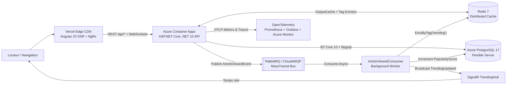

# QuébecInsider.ca — Plateforme Média Bilingue Cloud-Native (.NET 10 & Angular 20 SSR)

**QuébecInsider.ca** est une application Full-Stack d'architecture **Enterprise-Grade** bilingue (`fr-CA` / `en-CA`) conçue avec **ASP.NET Core (.NET 10)**, **Angular 20 SSR**, **PostgreSQL 17**, **Redis 7**, **RabbitMQ (MassTransit)**, **SignalR**, et une observabilité complète via **OpenTelemetry, Prometheus, Grafana et Azure Application Insights**.

## 🌐 Liens Production (Live)

- **Frontend (Vercel Edge + Angular 20 SSR)** : [https://quebec-insider.vercel.app](https://quebec-insider.vercel.app)
- **Backend API & Swagger (Azure Container Apps)** : [https://ca-quebecinsider-api.delightfulbeach-019eb41d.westus.azurecontainerapps.io/swagger](https://ca-quebecinsider-api.delightfulbeach-019eb41d.westus.azurecontainerapps.io/swagger)
- **Health Checks Cloud-Native** : `/health/live` & `/health/ready`

## 🏗️ Architecture Système



## 🚀 Fonctionnalités d'Ingénierie (Enterprise-Grade)

- **Architecture Événementielle Asynchrone (MassTransit + RabbitMQ / CloudAMQP)** : La consultation d'un article publie un `ArticleViewedEvent` non-bloquant. Le `ArticleViewedConsumer` met à jour `PopularityScore` dans PostgreSQL en arrière-plan, invalide le cache Redis (`EvictByTagAsync("trending")`) et diffuse le nouveau classement en direct via **SignalR (`TrendingHub`)**.
- **Caching Distribué & Protection API** : **Redis OutputCache** (`.NET 10`) avec invalidation par tags (`articles`, `trending`, `categories`) et **Rate Limiting** (`FixedWindowLimiter` `429 Too Many Requests`).
- **Sécurité & Validation** : Authentification **JWT Bearer** avec contrôle d'accès par rôle (`AdminOnly` sur `/api/admin/cache/evict`), validation stricte **FluentValidation** et erreurs normalisées **RFC 9457 (`ProblemDetails`)**.
- **Observabilité Complète (OpenTelemetry)** : Compteurs métiers personnalisés (`quebecinsider.articles.views`, `quebecinsider.searches.count`, `quebecinsider.events.processed`), traces distribuées (HTTP $\rightarrow$ EF Core SQL), scraping **Prometheus** (`/metrics`), tableaux de bord **Grafana** auto-provisionnés et **Azure Application Insights**.
- **DevOps, CI/CD & IaC** : Conteneurisation **Docker** multi-stage, pipeline **GitHub Actions** (`dotnet test` + publication `ghcr.io`), et Infrastructure-as-Code **Azure Bicep** (`infra/main.bicep`).

## 💻 Démarrage Rapide en Local

```bash
# 1. Démarrer l'infrastructure Docker locale (PostgreSQL 17, Redis 7, RabbitMQ, Prometheus, Grafana)
docker compose up -d

# 2. Exécuter les tests automatisés xUnit
dotnet test QuebecInsider.sln

# 3. Lancer l'API .NET 10 (http://localhost:5000/swagger & http://localhost:5295/metrics)
dotnet run --project backend/src/QuebecInsider.Api

# 4. Lancer le frontend Angular 20 (http://localhost:4200/fr)
cd frontend && npm install && npm start
```
